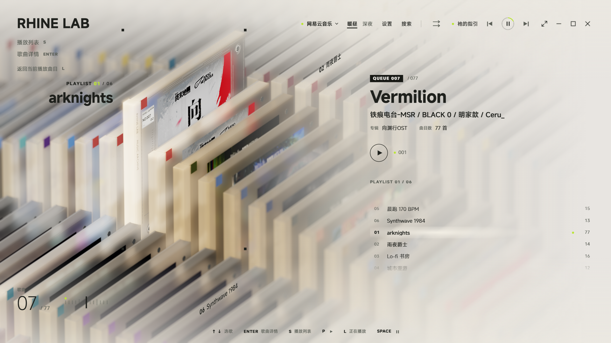
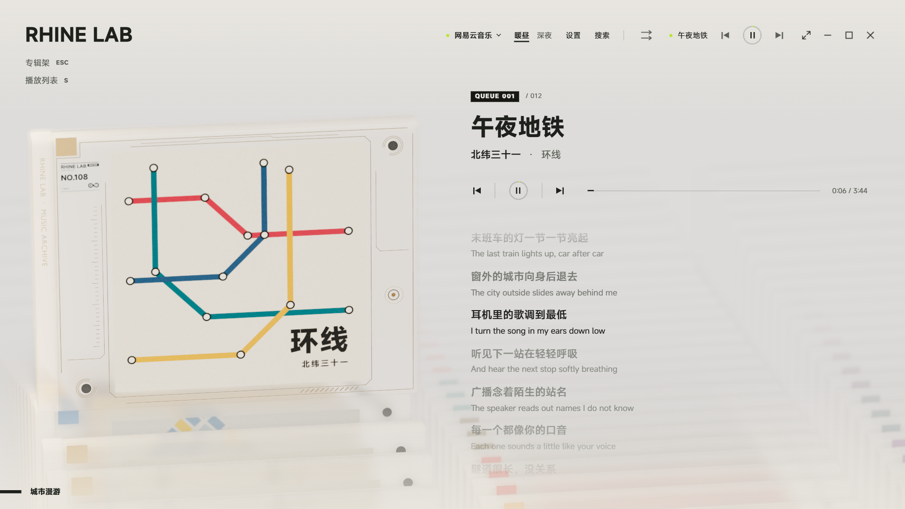
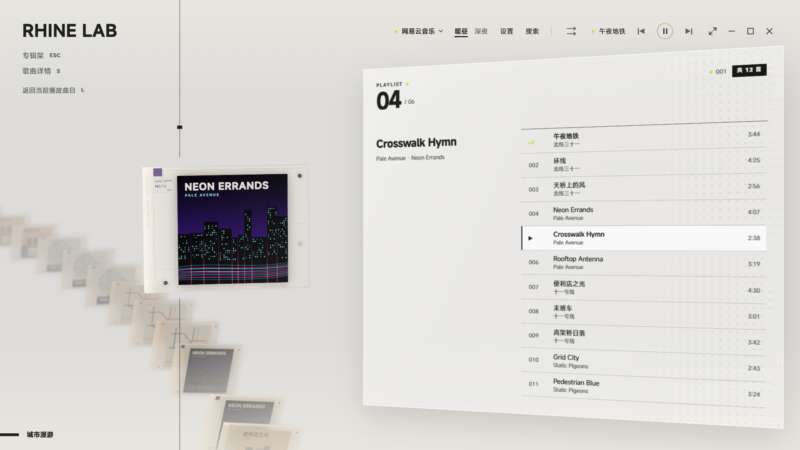
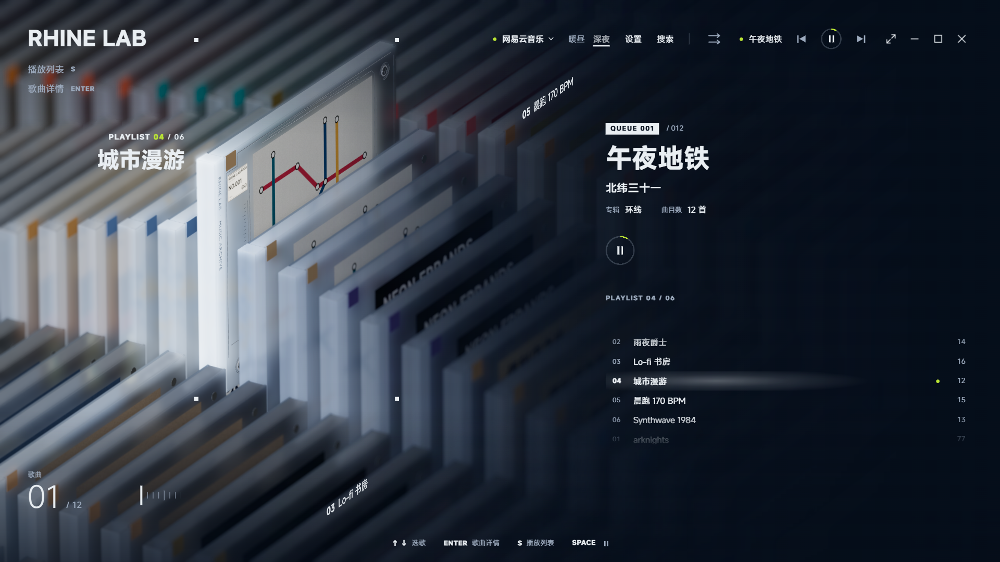

# Rhine Music · v1.0.0

**把正在听的歌，放进三维专辑架。**

一个自己用、也顺便分享的音乐客户端。用玻璃 CD 盒浏览歌曲，在专辑架、播放列表与歌曲详情之间切换；可以连接 Windows 上的网易云音乐，也可以播放本地音乐。

[下载 Windows 便携版](https://github.com/ccdr4gon/Rhine-Music/releases/tag/v1.0.0) · [观看宣传视频](https://github.com/ccdr4gon/Rhine-Music/releases/download/v1.0.0/rhine-music-intro-v1.0.0.mp4) · [更新记录](CHANGELOG.md) · [版权与来源](NOTICE.md)

音乐适配：[RonaldDeng](https://github.com/RonaldDeng) · Windows 客户端改编：ccdr4gon · 基于 [LBEILC / RhineLabUI](https://github.com/LBEILC/RhineLabUI)



## 三个界面

**专辑架**：每个歌单是一列，每首歌是一个盒子。左右切换歌单，滚轮逐首浏览。浏览本身不会打断正在播放的歌；点播放环播放选中的歌，点抬起的盒打开详情并播放。

**歌曲详情**：封面朝向你展开，歌曲信息与盒子同步切换。播放控制、进度线和时间放在同一行，歌词随播放推进。页面里的播放环属于这首歌；顶部的播放环始终暂停或继续当前正在播放的歌。



**播放列表**：一串封面和一份完整列表。单击选择，双击或点击行内 ▶ 播放。左侧只显示另外两个界面的入口；浏览别的歌时，显示“返回当前播放曲目”。



暖昼与深夜可以随时切换。标题栏提供搜索、播放模式和窗口按钮；“显示与性能”集中设置画质、帧率上限、减少动态效果与开场动画。



截图与视频使用同一组展示歌单：arknights，以及雨夜爵士、Lo-fi 书房、城市漫游、晨跑 170 BPM、Synthwave 1984 五个虚构歌单。虚构歌曲、封面和歌词只用于展示；程序不附带这些曲库或歌曲。[截图说明](docs/media/v1.0.0/README.md)

## 开始使用

Windows 版本是 **Tauri + Rust 独立客户端**，只提供 Portable ZIP。运行不需要 Node.js、npm、Rust 或外部浏览器；需要系统已有 Microsoft Edge WebView2，程序不会自动安装组件。

1. 下载并完整解压 **Rhine-Music-1.0.0-windows-x64-portable.zip** 到可写目录。
2. 进入 Rhine Music 文件夹，双击 **Rhine Music.exe**。不要在压缩包里运行，也不要单独移动 exe，旁边的 web/ 是必需资源。
3. 选择音乐来源：首次打开是本地音乐；点“音乐库”选择一个主文件夹并扫描，直接子文件夹会成为歌单。或者点标题栏当前来源按钮，选择已经打开的网易云音乐。

没有准备音乐时，可先查看演示歌单体验界面。再次启动会聚焦已有窗口；关闭窗口即退出程序。

### 网易云音乐

Rhine 显示和控制本机网易云，声音由网易云输出。在“设置 → 当前来源”中可显示播放队列、按歌单分列，并查看调试端口状态。浏览到另一首歌不会自动切歌；从 Rhine 点播放或打开详情，需要网易云的本机调试端口可用，未连接时会提示原因。设置里提供带确认的重启入口。

点击其他歌单里的歌播放时，网易云会从这首歌开始播放那个歌单，并替换自身队列。选中项停在正在播放的歌上时，画面跟随换歌；浏览别处时不会把你拉回。右上角歌名单击定位当前曲目，双击在任意界面打开它的详情。

标题栏的模式图标可切换顺序播放、列表循环、随机播放和单曲循环；网易云需调试端口，私人 FM／心动模式不在这里切换。Rhine 不提供账号登录、云端搜歌或付费歌曲访问。具体连接范围见[播放器说明](docs/PLAYERS.md)。

**v1.0.0 不支持 QQ 音乐。** 它不出现在来源列表里；旧版本记住的 QQ 连接会回到本地音乐，保留其他设置和曲库。其他标准 Windows 媒体会话按实际提供的能力连接，通常只有当前曲目，不能承诺完整播放列表。

### 本地音乐

主文件夹的每个直接子文件夹是一份歌单，更深层的歌曲归入该歌单。歌曲从原目录只读播放，不复制进程序、不修改标签。支持读取封面、歌名、歌手、专辑、格式和时长；介绍与 MusicBrainz 补全是可选项，缺失资料不会编造。

播放格式受 WebView2 音频支持限制。DSF／DFF 只索引、不承诺播放；QQ 的加密下载不能播放。支持本地 .lrc 歌词；网易云歌词按它实际提供的内容显示。没有频谱、均衡器、云同步、DLSS 或帧生成。

## 搜索与快捷键

搜索当前来源已经载入的歌曲、歌手、专辑和歌单。侧栏只列出有匹配的歌单，当前列表有结果时优先选中，否则选“全部”。点击结果立即请求播放并定位：同列表在当前页切换，跨列表保持当前页视角，盒子随镜头离场回落、入场抽出。

| 操作 | 功能 |
| --- | --- |
| ← / → | 切换歌单 |
| ↑ / ↓ 或滚轮 | 浏览歌单中的歌曲 |
| Enter / 点抬起的盒 | 打开歌曲详情并播放 |
| S | 专辑架、详情中打开播放列表；播放列表中打开详情 |
| Space / 顶部播放环 | 暂停或继续当前正在播放的歌 |
| P / 行内 ▶ | 播放选中的歌 |
| L / 返回当前播放曲目 | 只定位当前曲目，不改变播放状态 |
| / / 搜索 | 打开搜索 |
| Esc | 关闭面板、返回专辑架；全屏时先退出全屏 |

默认快捷键可在“设置 → 快捷键”修改。输入框和打开的面板保留自身键盘操作。播放列表单击选中、双击播放；详情中的进度线可点击、拖动和用键盘调整。已移除额外浏览箭头，播放器的上一首／下一首按钮仍保留。

## 数据与升级

Windows 默认在程序旁的 **data/** 保存设置、索引、封面缓存与 WebView 缓存。个人曲库、本机配置和账号信息不包含在源码、便携包或演示素材中。

升级前退出程序并备份 data/，用新包替换 exe、web/ 和许可文件，**保留自己的 data/**。需要改变数据位置时可设置绝对路径环境变量 MUSIC_DATA_DIR。应用不会自动寻找或迁移旧数据。

macOS 保留旧 Node 服务入口与 [v0.2.0 历史发布包](https://github.com/RonaldDeng/Rhine-Music-Demo/releases/tag/v0.2.0)；v1.0.0 的这份便携包仅用于 Windows。

## 开发与说明

Windows 构建需要 Node.js 22.12+、Rust MSVC 工具链、Visual Studio C++ 构建工具和 Windows SDK。

```powershell
npm ci
npm start                    # Tauri 开发运行
npm run desktop:portable     # 构建免安装 ZIP，不生成 MSI / NSIS
npm run check:music
npm run check:media
npm run check:desktop
```

- [Windows 构建与验证](docs/WINDOWS.md)
- [视觉与交互细节](DESIGN.md)
- [客户端结构](docs/architecture/overview.md)
- [音乐服务与数据](docs/MUSIC-SERVICE.md)
- [上游原版说明](README.original.md)

降低画质、关闭景深或限制帧率可减轻三维渲染开销。不同设备的表现会不同；演示视频采用逐帧录制，不能作为实时帧率的证明。

## 版权与来源

**音乐适配与后续修改：Copyright (c) 2026 RonaldDeng。**

**上游 RhineLabUI：Copyright (c) 2026 LBEILC。**

有权授权的代码、建模脚本及技术文档沿用 [MIT License](LICENSE)，两方署名和许可原文均保留；复用或分发代码及其重要部分时应继续保留。上游初始提交为 [`5abab023`](https://github.com/LBEILC/RhineLabUI/tree/5abab02367465d9189f4ae65bcb6f17fdb5938f7)，[原版说明](README.original.md)与 Git 历史一并保留。音乐适配不代表上游作者参与或认可本版本。

《明日方舟》及「莱茵生命：访问」中的名称、标志、设定、视觉和声音归相应权利人所有，本项目与官方无隶属关系。**代码 MIT 不自动覆盖模型、图像、字体或原 PV 采样，也不代替第三方授权。** MiSans、Rolling Number、Three.js、music-metadata、OpenCC-JS 等保留各自许可；原 PV 三个短音不纳入 MIT。完整来源、许可边界及对应文本请见 [NOTICE.md](NOTICE.md)。
